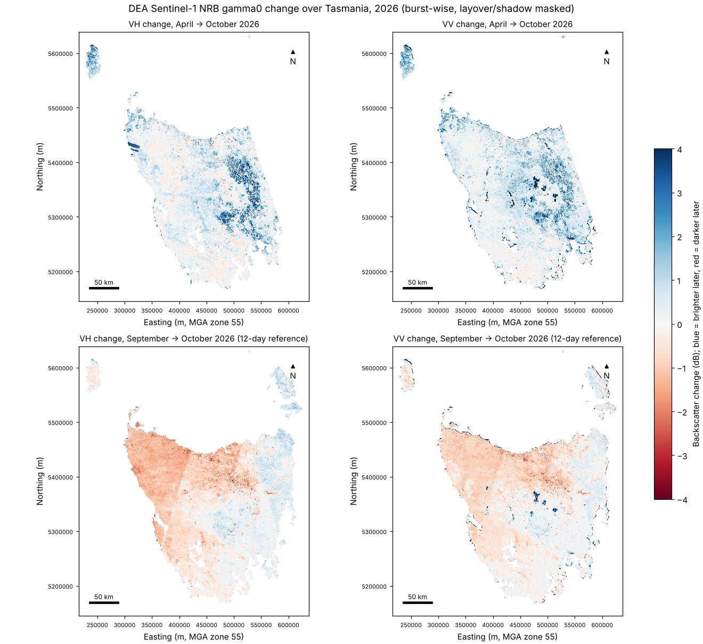

# Tasmania Sentinel-1 backscatter change, April vs October 2026 (DEA NRB)

Statewide radar change map from Geoscience Australia's Sentinel-1 Normalised Radar Backscatter
(NRB, Collection 1, IW VV+VH gamma0), built to run on Pawsey Setonix.

## Data

- `s3://dea-public-data-dev/baseline/ga_s1_nrb_iw_vv_vh_1/<burst>/YYYY/MM/DD/<time>/` per-burst
  COGs (UTM, 20 m, linear gamma0, internal overviews x4 x16 x64 x125) plus a STAC item JSON
  sidecar. Public, unsigned, read over HTTPS; no STAC API needed.
- Over Tasmania (checked 2026-11-10): 249 bursts on tracks 045 and 147 (descending) and 126
  (ascending). All have 30 Sep and 12 Oct 2026; 111 mainland bursts also have 20 Apr 2026.
  Flinders Island has no April date. `data/index_2026-11-10.json` is that burst list.
- DEA's full archive is due early 2027. Rebuild the index (`index` step) and widen the date
  pairs in `burst_change()` to use it.

## Method

For each burst, both dates come from the same burst, so the grids are identical (no
co-registration). Layover/shadow pixels (NRB mask != 0) are dropped, a 5 x 5 boxcar is applied in
linear power to cut speckle, and change = 10 log10(late / early) in dB. Two pairs:

| Band | Pair | Use |
|---|---|---|
| `vh_apr_oct`, `vv_apr_oct` | 20 Apr -> 12 Oct 2026 | Seasonal change plus any events |
| `vh_sep_oct`, `vv_sep_oct` | 30 Sep -> 12 Oct 2026 | 12-day reference: noise floor and weather |

Bursts are averaged onto one EPSG:28355 (MGA zone 55) grid, all tracks together and by orbit
direction, and open water is masked with Natural Earth 10 m land minus lakes (wind on water moves
backscatter by 5-20 dB between dates and swamps the land).

## Quicklook (80 m inputs, 100 m mosaic, run in a cloud sandbox)



Land-only stats (`figures/quicklook_stats_100m.json`):

| Band | Median (dB) | SD (dB) | > +3 dB | < -3 dB |
|---|---|---|---|---|
| VH Apr -> Oct | +0.27 | 1.03 | 3.0% | 0.15% |
| VV Apr -> Oct | +0.38 | 1.36 | 3.5% | 0.14% |
| VH Sep -> Oct | -0.34 | 0.78 | 0.08% | 0.21% |
| VV Sep -> Oct | -0.29 | 0.84 | 0.8% | 0.28% |

What it shows:

- **April -> October:** the Midlands, north-east and the eastern Central Plateau brighten by 2-4
  dB by spring (wetter soils and pasture growth after a dry autumn). The wet west and south-west
  barely change. That seasonal signal is much larger than any single event, so an event map
  needs a same-season baseline (the full archive will provide it).
- **12-day reference:** the noise floor is about 0.8 dB SD, but whole passes shift by about 1 dB
  with straight edges along track boundaries (the north-west on one pass): weather at overpass
  time, such as wet canopy or rain. Per-pass normalisation (subtract each burst's median) would
  remove most of it.
- **Artefacts:** small lakes missing from Natural Earth still show in VV; a striped strip on the
  north-west coast (x 300-330 km, y 5420-5440 km in MGA55) comes from near-coast iw3 bursts.
  Neither matters for land interpretation, but both are worth a look at 20 m.

## Run it

```bash
python tas_s1_change.py index                          # ~2 min, writes work/index.json
python tas_s1_change.py burst --level 0 --boxcar 5     # native 20 m (~30 s per burst per thread)
python tas_s1_change.py mosaic --res 20 --by-orbit
python tas_s1_change.py figure --res 20
python tas_s1_change.py all --level 1 --boxcar 3 --res 100   # quick look, as above
```

`TAS_S1_WORK` and `TAS_S1_OUT` set the working and output folders (default `work/`, `out/`).
At 20 m each burst output is ~30-65 MB, ~16 GB for the state; the 20 m mosaic needs ~40 GB RAM.

## Setonix setup (once, on a login node)

```bash
module load python/3.11.6     # Setonix needs an explicit version; see: module avail python
python -m venv $MYSOFTWARE/venvs/tas-s1
source $MYSOFTWARE/venvs/tas-s1/bin/activate
pip install -r requirements.txt
```

Then, from inside the repo folder, `sbatch --account=<project> setonix.slurm` (one node, 32 threads, under an hour). For the
full archive or all of Australia use `setonix_array.slurm`, one burst per array task, followed by
a dependent mosaic job (commands are in the file header). Outputs go to
`$MYSCRATCH/tas-s1-change/`. If you used a different Python module or venv path, set
`PYTHON_MODULE` and/or `TAS_S1_VENV` before `sbatch` (Slurm passes the environment through).

## Next steps

- Per-pass median normalisation, then a VH-drop map for forest clearing (plantation harvest in
  the north-east is the likely visible signal) and landslide scars.
- Same-season baselines once the 2027 archive lands, and a time-series step (per-pixel z-score
  against the stack) to flag events such as landslides or fire scars under cloud.
- Check flagged areas against DEA Sentinel-2 ARD for the same dates.
